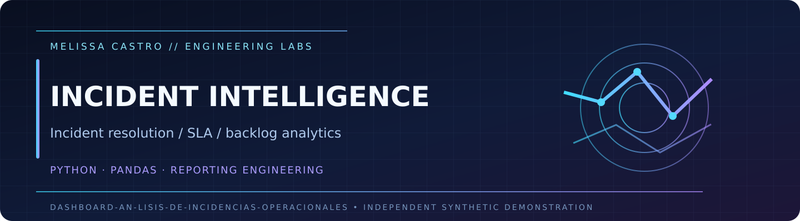
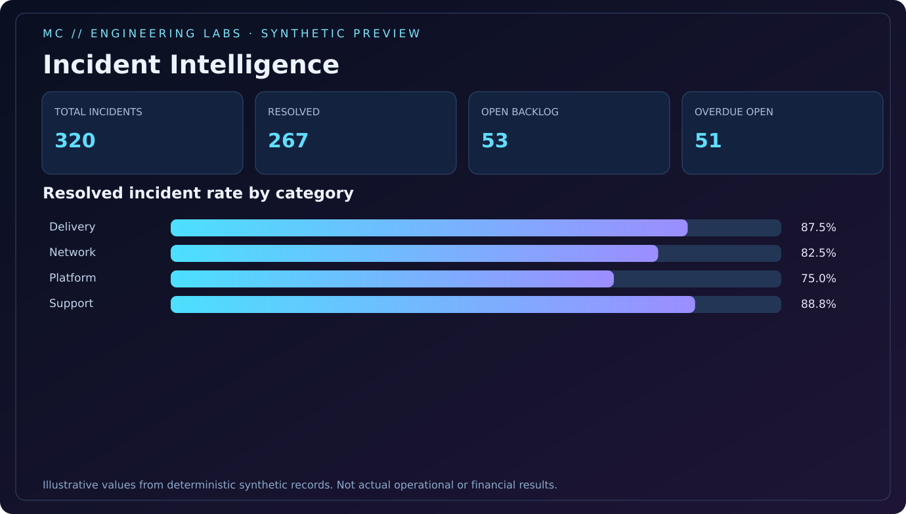

<p align="center"></p>
<p align="center"><a href="https://github.com/Dicureck/Dashboard-an-lisis-de-incidencias-operacionales/actions/workflows/ci.yml"></a>  </p>

# Operational Incident Intelligence

A reproducible **incident monitoring and operational reporting lab** for fictional support/service events: severity targets, backlog aging, response resolution, category-level KPIs and an offline dashboard.

> **Demonstration only.** All identities, incidents, severity policies, timestamps and service data are invented. No employer/customer source data, proprietary reports or actual performance outcomes.



## Run

```bash
python -m venv .venv
# Activate your environment.
python -m pip install -e '.[dev]'
python -m pytest -q
python -m operational_incident_intelligence demo --out-dir build/demo --seed 2026 --rows 320
```

Open `build/demo/dashboard.html` for a standalone HTML visualization or explore the [generated example](examples/synthetic-dashboard.html). Every dataset is synthetic and deterministic with an explicit seed.

## Implementation details

- One record per incident with validation of timestamps, severity, status and unique identifiers.
- Resolved-within-SLA denominator excludes unresolved incidents, **but open overdue/backlog is separately reported** to avoid misleading performance summaries.
- Snapshot based on a fixed synthetic reporting timestamp, not current live business time.
- Pandas pipeline exports `synthetic_incidents.csv` and `category_kpis.csv` for reproducibility.

| Document | Description |
|:--|:--|
| [Metric contracts](docs/kpi-contracts.md) | Formulas, denominators, limitations |
| [BI / reporting blueprint](docs/bi-reporting-blueprint.md) | DAX, reporting and Tableau design ideas |
| [Engineering decisions](docs/engineering-decisions.md) | Data integrity, time semantics, scope |
| [Python source](src/operational_incident_intelligence/core.py) | Generation and auditability |

Built for Melissa Castro's public engineering portfolio. Independent synthetic code; no company or customer materials. MIT license.

## Explore the interactive portfolio dashboard

[**Open Incident Intelligence interactive demo →**](https://dicureck.github.io/?demo=incidents#lab)

[Read the engineering case study →](https://github.com/Dicureck/Dicureck/blob/main/case-studies/incidents.md)

The interactive portfolio view uses **its own independently generated, deterministic fictional sample**. It is an exploration companion—not the same dataset as this repository and not a claim of cross-project reconciliation. Filter records, inspect metrics and export synthetic CSV directly in your browser.

**Publication note:** native Power BI / Tableau integrations are methodology examples until runnable native artifacts and independent tool validation are published. See the [BI calculation examples](https://github.com/Dicureck/Dicureck/blob/main/knowledge-base/bi-examples.md).
